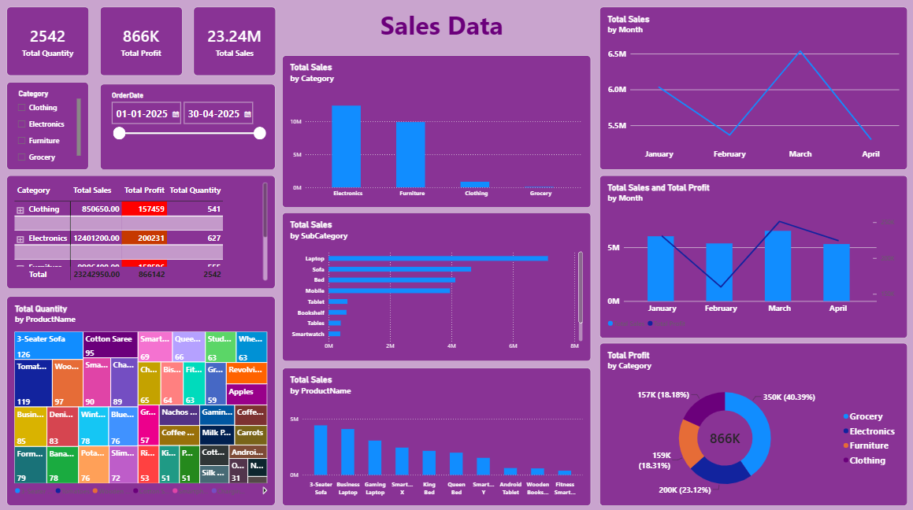

# Sales Dashboard (Power BI Practice Project)

A Power BI report built on a two-table sales dataset to practice data modelling, DAX measures and dashboard design.

**Data source:** Sales dataset from AI coach john YouTube Channel,
**Tools:** Power BI (data model, DAX), Excel

## Dataset

- `FactSales`: 200 orders from 1 January 2025 to 30 April 2025, with region, product, quantity, unit price, sales and profit.
- `DimProduct`: 40 products in 4 categories (Clothing, Electronics, Furniture, Grocery) and 22 sub-categories.
- The two tables are linked by `ProductID` (a star schema).

## What I built

- DAX measures: Total Sales, Total Profit, Total Quantity.
- KPI cards for the three measures.
- Monthly trend of sales (line chart) and of sales against profit (combo chart).
- Sales by category (column chart) and profit share by category (donut chart).
- Sales by product and sub-category (bar chart), product quantity (treemap), and a Category > Sub-category > Product table.
- Slicers for order date and category.
- A tooltip page with summary cards.

## Findings

- Which Category has the highest sales and which month is highest. Use only numbers you can see on the dashboard.

## Limitations

- The data covers only four months and 200 orders.
- In 75 of the 200 orders, profit is higher than sales, and profit does not rise with sales. These values are not realistic for a real business, so this project demonstrates modelling and visuals, not business conclusions.

## Files

- `Practice_data.pbix`: Power BI report
- `Sales_Dataset.xlsx`: source data (sheets `DimProduct` and `FactSales`)
- `dashboard.png`: screenshot
